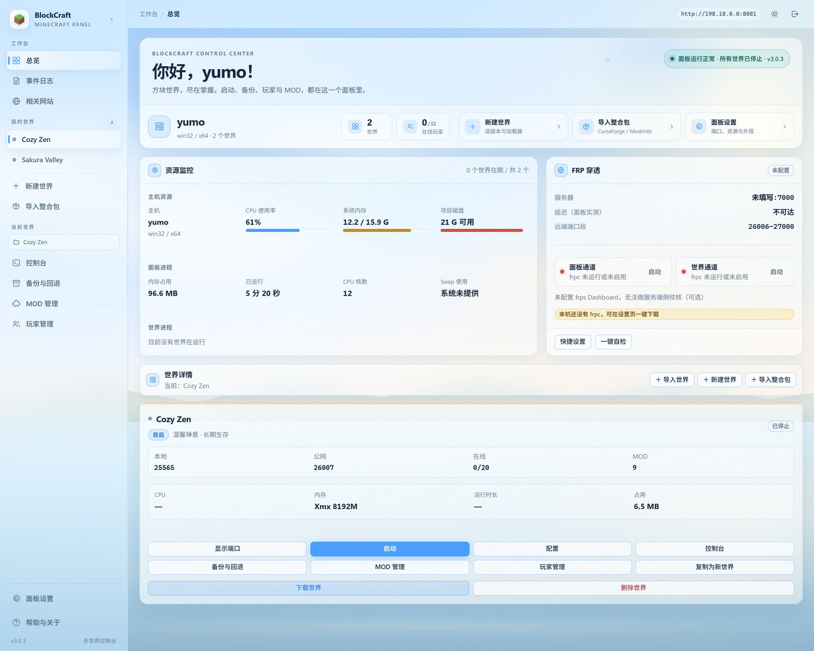
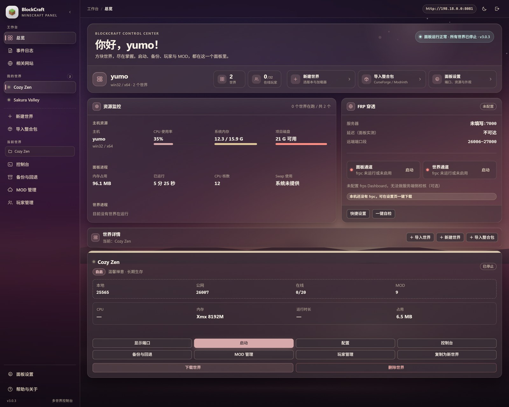
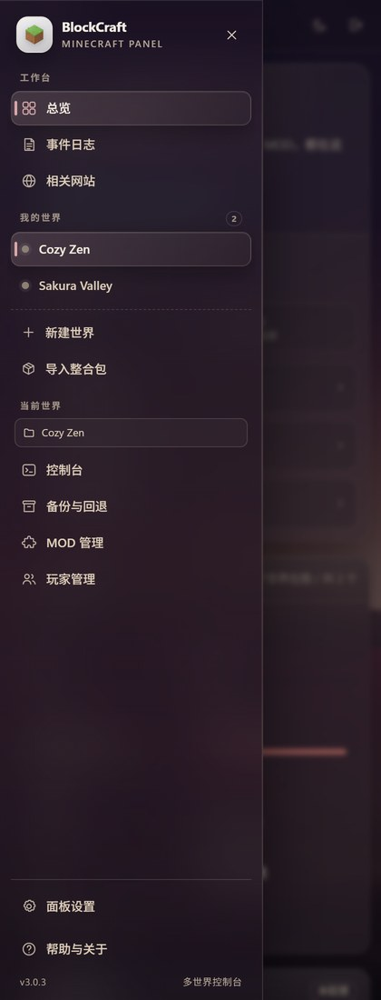

# BlockCraft

**多世界 Minecraft 服务端管理面板**。在一个网页里创建和管理多个独立世界，导入整合包、配置 Forge/Fabric 等加载器、管理 MOD 与玩家、备份迁移存档，并可用 FRP 提供远程访问。

[项目使用手册](docs/PROJECT_GUIDE.md) · [Windows x64 下载](https://github.com/yumo666666/blockcraft/releases/latest) · [更新记录](CHANGELOG.md)

## 界面预览

界面采用侧边栏 + 磨砂玻璃卡片布局，玻璃面板浮在壁纸之上，信息层级清楚又不遮挡背景。所有世界收在左侧「我的世界」下，一个世界占一行；点一下即切换右侧总览里的世界详情，并把选择同步到地址栏。外观提供「日光 / 暮色 / 跟随系统」三种选择，也可以在设置页上传自己的壁纸（只保存在当前浏览器）。

| 日光 | 暮色 |
|---|---|
|  |  |

总览集中显示主机资源、FRP 通道状态、世界运行状态、端口、在线人数、MOD 数量与资源用量。每个世界独立保存服务端、加载器、MOD、配置、存档、备份和日志。


移动端把侧边栏收进抽屉，世界列表和当前世界操作都能随手点开：



> 界面视觉语言致敬 [AlkaidLab · Foundation Sunshine](https://github.com/AlkaidLab/foundation-sunshine) 控制台。BlockCraft 只借鉴其「壁纸 + 磨砂玻璃」的设计思路，配色、组件、壁纸与代码均为独立实现。

## 功能

- **多世界管理**：分别启动、停止和重启多个 Minecraft 服务端。
- **创建和导入整合包**：支持原版、Paper、Forge、NeoForge、Fabric；解析 CurseForge 与 Modrinth 整合包清单并下载服务端文件。
- **游戏设置**：管理种子、模式、难度、PVP、允许飞行、白名单、视距、内存和游戏规则。
- **控制台和快捷命令**：查看实时日志、发送命令、使用玩家及世界管理快捷操作。
- **MOD 管理**：检索、下载、启用、停用、删除和检查依赖。
- **玩家与皮肤**：管理在线及已知玩家、管理员、白名单和封禁；支持共享皮肤池和可拖动的 3D 皮肤预览。
- **备份和迁移**：导出/上传 BlockCraft 备份 ZIP，回退世界存档。
- **FRP 穿透**：面板通道和世界通道分开运行，世界变更不会断开面板连接。
- **Linux 与 Windows**：Linux 启动脚本和 systemd 服务；Windows x64 便携发布包。

## 快速启动

### Windows

从 [GitHub Releases](https://github.com/yumo666666/blockcraft/releases/latest) 下载 `BlockCraft-Windows-x64.zip`，解压到可写目录后运行 `BlockCraft.exe`。首次打开会在浏览器访问本地面板。托盘菜单可打开面板、仅重启面板，或安全停止所有世界后退出。Windows 热更新步骤见[使用手册](docs/PROJECT_GUIDE.md#热更新)。

### Ubuntu / Debian

需要 Node.js 22.6+、Git 和联网环境。启动脚本会在项目目录准备 Node.js 运行时并构建网页。

```bash
git clone https://github.com/yumo666666/blockcraft.git
cd blockcraft
bash bin/ubuntu.sh
```

桌面环境浏览器会打开面板；若没有自动打开，按终端提示访问面板地址。终端会显示首次登录令牌。需要后台开机启动时，按手册中的 systemd 步骤安装服务。

更新源码安装并保留正在运行的世界：

```bash
bash bin/hot-update.sh
```

脚本会等待创建、导入和安装任务结束，拉取跟踪分支的最新代码，只停止并重启管理面板。运行中的 Minecraft 世界会继续运行。

### Docker

```bash
git clone https://github.com/yumo666666/blockcraft.git
cd blockcraft
docker compose up -d
```

初次启动令牌位于 `data/panel.json`。游戏端口范围与面板端口需要按网络环境开放。

## 从源码运行

要求 Node.js ≥ 22.6、Corepack/pnpm、Git；Windows 发布包还需要 Go 编译器和网络。

```bash
git clone https://github.com/yumo666666/blockcraft.git
cd blockcraft
corepack enable
corepack pnpm install --frozen-lockfile
corepack pnpm build
node --experimental-strip-types server/src/index.ts
```

更多安装步骤、每个页面的图文说明、整合包导入、FRP、备份迁移和玩家皮肤演示见 **[BlockCraft 使用手册](docs/PROJECT_GUIDE.md)**。

## 项目结构

```text
server/src/                 Node.js 服务端：core、routes、services、launcher
web/src/                    Vue 网页：pages、components、lib、styles
bin/                        Linux/Ubuntu 启动、停止、看门狗与 systemd 脚本
packaging/windows/          Windows 托盘启动器、关闭窗口与构建脚本
docs/                       图文手册、截图、关闭窗口图和皮肤演示视频
data/                       面板配置、玩家/皮肤缓存、日志、下载缓存和 Java
instances/<世界ID>/         每个世界的配置、状态、日志、备份和服务端目录
  server/                   Minecraft 服务端：MOD/插件/配置/整合包文件
    <level-name>/            世界存档目录，默认叫 world，也可以自定义名称
      region/                区块地形数据（*.mca）
      playerdata/            玩家背包、位置、经验等角色存档
      advancements/ stats/    玩家进度和统计数据
      data/ datapacks/        世界数据和数据包
```

完整仓库源码树、`data/` 运行数据，以及每个世界和存档内部的示例结构见[项目使用手册第 11 节](docs/PROJECT_GUIDE.md#11-项目目录)。
